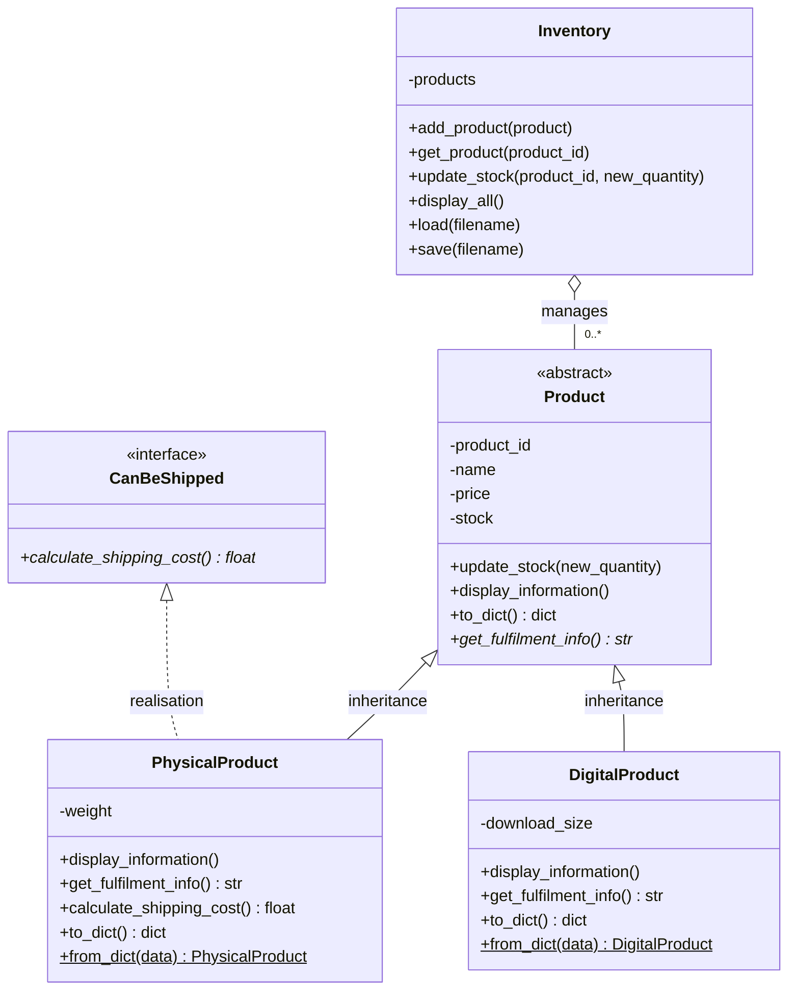

# UML class diagram (Mermaid)

Render at https://mermaid.live, then redraw in your lecture's notation
(<<abstract>> label, italics for abstract methods).

Notation reminders:
- Inheritance: SOLID line, hollow triangle at Product.
- Interface realisation: DASHED line, hollow triangle at CanBeShipped (PhysicalProduct only).
- Inventory to Product: association/aggregation with 0..* at the Product end.
